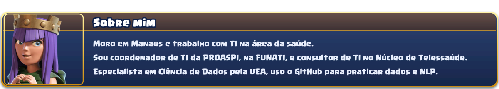
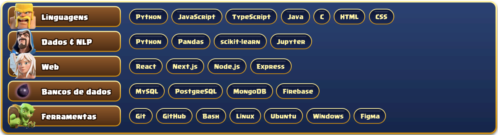
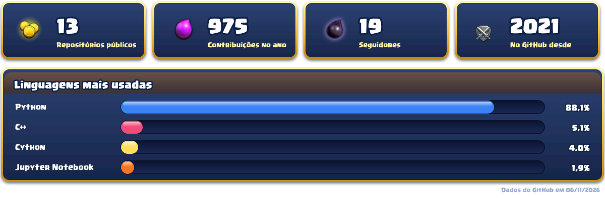

  

  
  
  
  

  

  

<h2 align="center"></h2>

  
  

<h2 align="center"></h2>

  

<h2 align="center"></h2>

  

  

<h2 align="center"></h2>

  

Nunca se acomode, sempre suba de nível! ⭐ Se gostou do perfil, me siga!

Conteúdo de fã, sem fins comerciais. Imagens e fonte do Clash of Clans: © Supercell, via Fan Kit oficial. Este perfil não é afiliado nem endossado pela Supercell.

