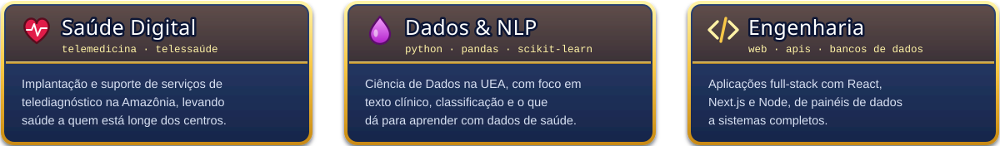
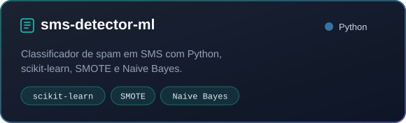
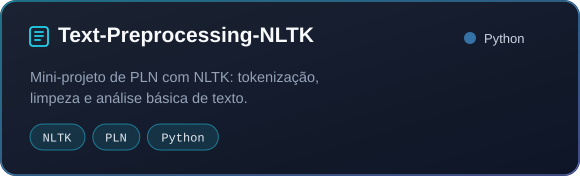

  

  
  
  
  

  Moro em Manaus e trabalho com TI na área da saúde. 
  Sou coordenador de TI da PROASPI, na FUNATI, e consultor de TI no Núcleo de Telessaúde. 
  Especialista em Ciência de Dados pela UEA, uso o GitHub para praticar dados e NLP.

  

## 🏰 Construções em destaque

  
  

## ⚔️ Tropas & Ferramentas

<table align="center">
  <tr>
    <td><b>💻 Linguagens</b></td>
    <td></td>
  </tr>
  <tr>
    <td><b>📊 Dados &amp; NLP</b></td>
    <td></td>
  </tr>
  <tr>
    <td><b>🚀 Web</b></td>
    <td></td>
  </tr>
  <tr>
    <td><b>🗄 Bancos de dados</b></td>
    <td></td>
  </tr>
  <tr>
    <td><b>🛠 Ferramentas</b></td>
    <td></td>
  </tr>
</table>

## 🏆 Troféus & Estatísticas

  
    
  
  
   
  
  

## 🐍 Atividade & Contribuições

  

Nunca se acomode, sempre suba de nível! ⭐ Se gostou do perfil, me siga!

Conteúdo de fã, sem fins comerciais. Inspirado em Clash of Clans, não é afiliado nem endossado pela Supercell.

